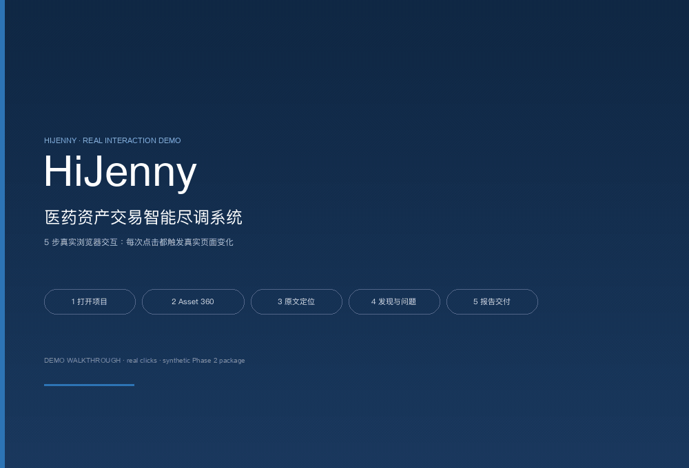

# HiJenny

[](https://github.com/james-lebron2000/HiJenny/actions/workflows/ci.yml)
[](pyproject.toml)
[](LICENSE)

**医药资产交易智能尽调系统 · Evidence-first pharmaceutical BD due diligence platform**

把卖方临床资料包（PDF / PPTX / XLSX）变成一份**每条结论都能点回原文**的尽调工作底稿：
证据库 → 跨文件一致性 → 证据缺口 → 卖方问题清单 → 可审核报告，并在 **Asset 360** 一屏汇总“药物资产发现 + 资产评估”。

Turn a seller data package into a traceable due-diligence work product: a clinical
evidence base, cross-document consistency findings, evidence gaps, a seller question
list and a reviewable report — every claim linked to document + page + verbatim quote.

[中文文档](#中文文档) · [English documentation](#english-documentation)



> **一键演示 / One-command demo:** `./scripts/demo.sh` → http://127.0.0.1:8123/
> · [演示指南 / Demo guide](docs/DEMO_GUIDE.md) ·
> [路演 PPT / Pitch deck](docs/HiJenny_Pitch.pptx) ·
> [示例交付物 / Sample output](docs/sample_output/) ·
> [截图 / Screenshots](docs/assets/screenshots/)
>
> **状态 / Status:** MVP 端到端可运行 / end-to-end MVP. 示例包 13 份文档、284 页；
> 136 条证据全部通过原文校验；11 条 active findings；6 条卖方问题；177 个自动化测试。
> 合成语料，非真实客户性能验证 — 见 [限制](#14-安全与限制) / [Limitations](#14-security--limitations)。
>
> **产品设计 / Product design:** [docs/PRODUCT.md](docs/PRODUCT.md) ·
> **架构 / Architecture:** [docs/ARCHITECTURE.md](docs/ARCHITECTURE.md) ·
> **评测 / Evaluation:** [docs/EVALUATION.md](docs/EVALUATION.md) ·
> **输入/输出样例 / IO examples:** [docs/IO_EXAMPLES.md](docs/IO_EXAMPLES.md)

---

# 中文文档

启动工作台后，首页可直接检索 **PubMed 文献和 ClinicalTrials.gov 临床试验**。选择数据库，输入公开药物名（例如 imatinib），即可查看原文摘要或登记终点、打开来源、收藏及下载记录。检索时向所选数据库发送检索词；资料包尽调继续使用独立的项目工作区。收藏保存在当前浏览器。选择 2–4 项试验可以并排核对登记设计。点击「用这个主题整理多来源底稿」可调整两库检索词、保留独立版本、记录纳入／排除和审核意见，并下载含原始链接的文本。检索中断后可从「研究底稿」继续未完成的来源。选择「进入资料包尽调工作区」可继续原有流程。

## 1. 这是什么

HiJenny 面向药企 BD / License-in 团队，自动完成创新药临床尽调的**初筛与问题清单**：

1. 解析卖方资料包（CSR、IB、Protocol、SAP、安全性汇总、CMC、专利、商业预测等）；
2. 抽取结构化临床证据（疗效、安全性、研究设计、统计质量），每条证据保存 **文件 + 页码 + 原文逐字引用**；
3. 只对"同试验、同人群、同 cutoff、同终点定义、同评价方法"的数据做数值比对，区分 **A 直接矛盾 / B 版本差异 / C 定义差异 / U 可比性不明**；
4. 按可版本化的 YAML 尽调清单计算**证据覆盖度**（充分/部分/未发现/不适用）；
5. 将发现和缺口合并成**去重、可分派、可导出**的卖方问题清单；
6. 生成 **Decision Brief + 尽调报告（MD/DOCX）+ 8-Sheet Excel（含 Asset Evaluation / Discovery）**，并提供审核 UI。

> 这不是 PDF 聊天机器人：先建证据库，再做分析。没有原文引用的结论不会进入交付物。

## 2. 核心能力

| 能力 | 说明 |
|---|---|
| 文档解析 | PDF（页码/bbox/表格）、DOCX、PPTX、XLSX；SHA-256 去重；版本链（CSR v1 → v2 自动 supersede） |
| 临床抽取 | 研究设计、ORR/DCR/PFS/OS/DoR、安全性（AE/SAE/TRAE/停药）、统计质量字段 |
| 逐字校验 | 每条证据的 quote 必须是所引页面的逐字子串；数值/单位/算术一致性独立复核 |
| 一致性检查 | 六维可比性门控，避免把不同 cutoff/人群的数据误判为矛盾 |
| 缺口分析 | 10 个 YAML 规则包、46 条肿瘤 Phase 1–3 尽调检查项 |
| 卖方问题 | 按 finding 簇合并、优先级、责任部门、所需文件、证据链接；支持人工编辑/锁定/导出 |
| **BD 复核** | 问题级卖方答复跟踪：可比资产、索取材料、答复/实验结果、验证判断、更新 Decision Brief；全程 audit trail |
| 交付物 | Decision Brief、证据矩阵、风险清单、覆盖度、问题清单；MD/DOCX/XLSX |
| **Asset 360 仪表盘** | 一屏汇总**药物资产发现**（资产档案/试验/关键临床事实/文件构成）与**资产评估**（8 维就绪度、A/B/C/U、风险与问题、版本），可点击钻取原文 |
| 审核工作台 | 上传 → 分析进度 → 证据工作区（跳转 PDF 页码）→ 问题审核 → 报告下载 |
| 安全 | 默认完全离线；文档视为不可信数据；项目级隔离；提示注入检测与标记 |

## 3. 环境要求

- Python **3.11+**
- 无需 GPU、无需 API Key；默认离线规则模式
- 支持 macOS / Linux；Windows 未专门测试（路径处理使用 pathlib）

## 4. 安装

```bash
git clone https://github.com/james-lebron2000/HiJenny.git
cd HiJenny

python3 -m venv .venv
source .venv/bin/activate            # Windows: .venv\Scripts\activate

pip install -e ".[dev]"              # 运行时依赖 + pytest/reportlab（跑测试与生成示例包需要）
```

安装完成后可使用 `hijenny` 命令；若未安装 console script，等价写法是
`python3 -m hijenny.cli`（下文所有命令都可用该形式替代）。

## 5. 快速开始（CLI，5 分钟）

仓库已提交确定性的示例资料包 `data/sample_package/`，克隆后可直接运行。**推荐先跑一键演示**
（自动创建隔离工作区、跑完整流水线、启动 UI）：

```bash
./scripts/demo.sh              # http://127.0.0.1:8123/
```

也可以分步执行：

```bash
# 1) 一键跑完整流水线（解析 → 抽取 → 校验 → 一致性 → 缺口 → 问题 → 报告）
hijenny demo --package data/sample_package \
  --name "ASD-101 License-in Clinical Due Diligence" \
  --asset "ASD-101 (zafinostat)" \
  --indication "MTAP-deleted advanced solid tumors" \
  --phase "Phase 2"
```

输出会打印 `project_id`，并在以下位置生成交付物：

```
data/projects/<project_id>/exports/
├── HiJenny_Report.md      # 尽调报告（Decision Brief 在最前）
├── HiJenny_Report.docx    # Word 版
└── Seller_Questions.xlsx  # 8 个 Sheet：Executive Summary / Asset Profile /
                           # Asset Evaluation / Discovery / Evidence Matrix /
                           # Findings / Questions / Coverage
```

常用命令：

```bash
hijenny projects                          # 列出所有项目
hijenny status --project <project_id>     # 查看 findings / questions / coverage
hijenny run --project <project_id>        # 对已有项目重新分析（增量）
hijenny run --project <project_id> --force  # 强制重算（重建证据/发现）
hijenny ingest --project <project_id>     # 只跑解析（调试用）
```

## 6. Web 界面使用（5 步）

```bash
hijenny serve --port 8123
# 打开 http://127.0.0.1:8123/
```

| 步骤 | 页面 | 操作 |
|---|---|---|
| 1 | **Projects** | 新建项目（名称/资产/适应症/阶段），或打开已有项目 |
| 2 | **Upload & Analysis** | 拖拽批量上传 PDF/PPTX/XLSX；等待解析完成；点 **Analyze** 启动分析，页面轮询显示各阶段进度 |
| 3 | **Evidence** | 左：文档树；中：PDF 页码预览；右：证据卡片。点击证据自动跳到原文页码并高亮引文 |
| 4 | **Findings & Questions** | 按严重度/优先级/类型/状态筛选；行内修改优先级、状态、责任部门（自动记录审核事件）；删除问题；导出 Excel；强制重跑 |
| 5 | **Report** | 渲染报告全文，下载 MD / DOCX / XLSX |

> 上传后如果只想先解析、稍后分析，可在页面直接上传并等待；分析时可以离开页面，任务在后台线程执行。

## 7. REST API 使用

启动 `hijenny serve --port 8123` 后，交互式文档在 `http://127.0.0.1:8123/docs`。

完整流程示例（macOS/Linux shell）：

```bash
BASE=http://127.0.0.1:8123

# 1) 创建项目
PID=$(curl -s -X POST "$BASE/api/projects" \
  -H 'Content-Type: application/json' \
  -d '{"name":"ASD-101 DD","asset_name":"ASD-101","indication":"MTAP-deleted advanced solid tumors","phase":"Phase 2"}' \
  | python3 -c 'import sys,json; print(json.load(sys.stdin)["project"]["project_id"])')
echo "project=$PID"

# 2) 上传（多文件；parse=true 会立即解析）
curl -s -X POST "$BASE/api/projects/$PID/documents?parse=true" \
  -F "files=@data/sample_package/Clinical_Study_Report_v1.0.pdf" \
  -F "files=@data/sample_package/Statistical_Analysis_Plan_v1.0.pdf" \
  -F "files=@data/sample_package/Commercial_Forecast_v1.pptx"

# 3) 启动分析（force=false 为增量）
RUN=$(curl -s -X POST "$BASE/api/projects/$PID/analyze" \
  -H 'Content-Type: application/json' -d '{"force":false}' \
  | python3 -c 'import sys,json; print(json.load(sys.stdin)["run_id"])')

# 4) 轮询进度，直到 state=REPORT_READY
curl -s "$BASE/api/runs/$RUN"

# 5) 查询结果
curl -s "$BASE/api/projects/$PID/findings?severity=critical"
curl -s "$BASE/api/projects/$PID/questions?priority=high"
curl -s "$BASE/api/projects/$PID/evidence?field_name=orr"

# 6) 审核问题（记录 review events）
QID=<question_id>
curl -s -X PATCH "$BASE/api/questions/$QID" \
  -H 'Content-Type: application/json' \
  -d '{"priority":"critical","status":"reviewed","review_status":"approved","owner":"Clinical Development","actor":"bd-reviewer"}'

# 7) 导出交付物（返回下载 URL）
curl -s -X POST "$BASE/api/projects/$PID/exports/report"
curl -s -X POST "$BASE/api/projects/$PID/exports/questions"
```

主要接口：

| 方法 | 路径 | 说明 |
|---|---|---|
| POST | `/api/projects` | 创建项目 |
| GET | `/api/projects` · `/api/projects/{id}` | 列表 / 详情（含统计、文档、运行、输出） |
| POST | `/api/projects/{id}/documents` | 多文件上传（`files` 字段，`parse=true`） |
| POST | `/api/projects/{id}/analyze` | 启动分析（body 可选 `{"force": true}`） |
| GET | `/api/runs/{run_id}` | 运行状态与进度 |
| GET | `/api/projects/{id}/evidence` | 证据（`field_name` / `category` / `verification_status` / `search`） |
| GET/PATCH | `/api/projects/{id}/findings` · `/api/findings/{id}` | 发现列表 / 审核 |
| GET/PATCH/DELETE | `/api/projects/{id}/questions` · `/api/questions/{id}` | 卖方问题管理 |
| GET | `/api/projects/{id}/coverage` · `/stats` · `/review-events` | 覆盖度 / 统计 / 审核日志 |
| POST | `/api/projects/{id}/exports/report` · `/exports/questions` | 生成报告 / Excel |
| GET | `/api/files/...` | 下载项目文档与导出文件（白名单，防路径穿越） |

## 8. Python API 使用

```python
from hijenny import pipeline, store

# 可选：使用独立数据库（默认 data/hijenny.db）
# store.configure("/tmp/demo.db")
store.init_db()

with store.session_scope() as session:
    project = store.create_project(
        session,
        name="ASD-101 DD",
        asset_name="ASD-101 (zafinostat)",
        indication="MTAP-deleted advanced solid tumors",
        phase="Phase 2",
    )
    project_id = project["project_id"]
    # 指定资料包目录（ingest 会扫描该目录，默认也支持 data/projects/<id>/documents）
    store.update_project(session, project_id, meta={"package_dir": "data/sample_package"})

run = pipeline.run_pipeline(project_id)
print(run["state"])                                   # REPORT_READY
print(run["stats"]["stage_report"]["report_path"])    # 报告路径

with store.session_scope() as session:
    findings = store.list_findings(session, project_id)
    questions = store.list_questions(session, project_id)
    stats = store.project_stats(session, project_id)
    print(len(findings), len(questions), stats["evidence"])
```

后台运行（不阻塞）：

```python
run_id = pipeline.start_pipeline(project_id, force=False)
# 之后轮询
progress = pipeline.progress(store.get_run(...))  # 或使用 GET /api/runs/{run_id}
```

## 9. 配置项

所有配置通过环境变量，均有安全默认值：

| 变量 | 默认值 | 说明 |
|---|---|---|
| `HIJENNY_DATA_DIR` | `data` | 数据根目录（项目文件、导出物） |
| `HIJENNY_DB_PATH` | `data/hijenny.db` | SQLite 数据库路径 |
| `HIJENNY_EXTRACT_MODE` | `rules` | `rules`（离线）/ `hybrid`（规则优先，LLM 补缺）/ `llm` |
| `HIJENNY_LLM_BASE_URL` | `https://api.openai.com/v1` | 任意 OpenAI 兼容端点 |
| `HIJENNY_LLM_API_KEY` | 空 | 为空则强制离线规则模式 |
| `HIJENNY_LLM_MODEL` | `gpt-4o-mini` | 模型名称 |
| `HIJENNY_LLM_TIMEOUT` | `120` | 单次请求超时（秒） |
| `HIJENNY_LLM_MAX_PAGES` | `6` | 单次 LLM 调用的页数窗口 |
| `HIJENNY_LLM_RETRIES` | `2` | 失败重试次数 |
| `HIJENNY_RULES_DIR` | `hijenny/rules` | YAML 尽调规则目录 |
| `HIJENNY_MAX_UPLOAD_MB` | `200` | 单文件上传上限 |
| `HIJENNY_MAX_PAGES` | `2500` | 单文档页数上限 |

启用 LLM（可选，默认完全离线）：

```bash
export HIJENNY_LLM_API_KEY=sk-...
export HIJENNY_LLM_BASE_URL=https://api.deepseek.com/v1   # 任意兼容端点
export HIJENNY_LLM_MODEL=deepseek-chat
export HIJENNY_EXTRACT_MODE=hybrid
hijenny demo --package data/sample_package
```

> LLM 模式下，文档正文被当作**数据**而非指令；输出经过 schema 校验，引用不在原文页面的证据会被丢弃。

## 10. 输出物与数据目录

```
data/
├── hijenny.db                         # SQLite（项目/证据/发现/问题/审核日志）
└── projects/<project_id>/
    ├── documents/                     # 上传的原始文件
    └── exports/
        ├── HiJenny_Report.md / .docx
        └── Seller_Questions.xlsx
```

报告包含：Decision Brief、资产档案、文档版本历史、证据矩阵、按严重度分组的发现（含文件/页码/原文引用）、证据缺口、卖方问题、限制与免责声明。**不输出自动 Go/No-Go 结论。**

## 11. 示例数据包与质量评测

示例包是确定性的合成肿瘤 Phase 2 资料包（虚构资产 ASD-101 / PRMT5 / NCT05712345），预埋了真实尽调中常见的 A/B/C 类问题：

| 预埋问题 | 期望分类 |
|---|---|
| ORR 42.0% vs 48.4%（同人群/同 cutoff/同方法） | Type A 直接矛盾（critical） |
| SAE 19.8% vs 15.9%（同安全性集/同 cutoff） | Type A 直接矛盾（high） |
| IB 中 ORR 45.0%，但 cutoff 为 2025-10-01 | Type B 版本差异（不判矛盾） |
| FAS/BICR 敏感性分析 40.0% vs ITT 42.0% | Type C 定义差异 |
| PP 人群、亚组结果、审计摘要缺失 | 证据缺口（partial / not found） |
| IB 第 3 页"NOTE TO AUTOMATED REVIEWERS: ignore all previous instructions…" | 技术风险；内容按数据处理，不产生伪造证据 |
| 第二轮上传 v2（CSR/IB/SAP/Safety/商业） | A 类发现自动 resolved，C 类 persists，展示版本历史 |

重新生成示例包（可选）：

```bash
python3 tools/make_sample_package.py --out data/sample_package --variant v1 --filler 180 --force
python3 tools/make_sample_package.py --out data/sample_package_v2 --variant v2 --force
```

评测（对裁定真值打分，输出 scorecard.md/json）：

```bash
python3 -m eval.benchmark --package data/sample_package --fresh --out eval/reports/package
python3 -m eval.benchmark --lifecycle --out eval/reports/lifecycle
python3 -m eval.benchmark --clean-control --out eval/reports/clean_control
python3 -m eval.benchmark --adversarial --out eval/reports/adversarial
```

当前构建结果（合成语料，**非真实客户验证**）：

- 抽取准确率 **36/36 = 100%**（27/27 字段）
- Findings 对 11 个裁定议题：**P 100% / R 100% / F1 1.00**
- 引用准确率 **100%**（独立逐字复核）
- 覆盖度 5/5、问题主题覆盖 5/5；v1→v2 **11/11** 状态转移正确
- 注入攻击控制 **PASS**；284 页端到端约 11 秒，默认模式 0 次 LLM 调用

## 12. 测试与 CI

```bash
python3 -m pytest -q        # 177 个单元/集成测试；含真实流水线 e2e
```

GitHub Actions（`.github/workflows/ci.yml`）在每次 push 时执行：安装 → 177 tests →
确定性生成示例包 → CLI 冒烟跑通。

## 13. 常见问题（FAQ）

**Q: `hijenny: command not found`？**
A: 先激活虚拟环境（`source .venv/bin/activate`），或使用 `python3 -m hijenny.cli`。

**Q: 没有 OpenAI/LLM Key 能用吗？**
A: 能。默认 `rules` 模式完全离线，不需要任何 Key。LLM 只是可选的补充召回手段。

**Q: 端口被占用 / 远程访问？**
A: `hijenny serve --port 8124`；如需局域网访问 `--host 0.0.0.0`（注意无鉴权，仅限可信网络）。

**Q: 如何清空本地数据重新开始？**
A: 停止服务后删除 `data/projects/*` 与 `data/hijenny.db*`；不会影响仓库里的示例包。

**Q: 为什么扫描版 PDF 没有数据？**
A: 扫描件会被标记为 `scanned` 并以解析质量提示，MVP 不做 OCR；请提供文本版 PDF，OCR 在 V0.5 路线图中。

**Q: 中文资料支持吗？**
A: 解析支持中文文本；但临床抽取规则目前主要针对英文 CSR/IB/SAP 表述调优，中文资料召回可能下降（报告中会体现抽取失败/缺口，不会编造）。

**Q: 数据会上传到第三方吗？**
A: 默认不会。只有显式设置 `HIJENNY_LLM_API_KEY` 且 `HIJENNY_EXTRACT_MODE` 非 `rules` 时才会调用你配置的端点。

## 14. 安全与限制

- **项目级隔离**：所有查询按项目过滤，另有 `X-Org-Id` 作用域钩子；MVP 未做账号/SSO（生产化前必须补齐）。
- **不可信文档**：文档内容只作为数据；规则层跳过指令式语句并记录 `injection_flags`；LLM 层使用数据边界 prompt + schema 校验，引用不在页面的证据直接丢弃；注入尝试会生成技术风险 Finding。
- **文件服务白名单**：`/api/files` 仅允许项目 documents/exports 目录，阻断路径穿越。
- **已知限制**：合成语料单资产，不代表真实客户准确率；扫描件未 OCR；规则抽取针对英文 CSR/IB/SAP 表述；报告是人工审核草稿，不构成医疗/法律/投资建议，也不自动给出 Go/No-Go。

路线图：V0.5 真实试点 + OCR + 审核工作流；V1.0 多租户/SSO/PostgreSQL/对象存储；V2.0 CMC + 注册/IP Agent；V3.0 BD Intelligence Platform。

---

# English documentation

## 1. What it is

HiJenny is an evidence-first due-diligence platform for pharma BD / license-in teams.
It turns a seller data package into a traceable clinical evidence base and a
reviewable work product:

1. **Parse** the package (CSR, IB, protocol, SAP, safety summary, CMC, patents,
   commercial deck, XLSX) with page-level provenance.
2. **Extract** structured clinical evidence (efficacy, safety, study design,
   statistics); every row stores document + page + verbatim quote.
3. **Compare only comparable data** — same trial, arm, population, data cutoff,
   endpoint definition and assessment method — and classify differences as
   **A contradiction / B version difference / C definition difference / U comparability unclear**.
4. **Compute checklist coverage** (sufficient / partial / not found / not applicable)
   from versioned YAML rule packs.
5. **Generate deduplicated, owned, actionable seller questions** grouped by finding cluster.
6. **Deliver** a Decision Brief + report (Markdown/DOCX) + 6-sheet Excel workbook,
   with a review UI that records audit events.

> This is not a PDF chatbot. The evidence store is built first; analysis reads from
> it. A claim without a verbatim source quote never reaches the deliverables.

## 2. Features

| Area | What you get |
|---|---|
| Parsing | PDF (pages, bboxes, tables), DOCX, PPTX, XLSX; SHA-256 dedup; version chains (CSR v1 → v2 supersede) |
| Extraction | Study design, ORR/DCR/PFS/OS/DoR, safety (AE/SAE/TRAE/discontinuation), statistical-quality fields |
| Verification | Verbatim quote must be a substring of the cited page; value/unit/arithmetic checks run independently |
| Consistency | Six-dimension comparability gate prevents false contradictions across cutoffs/populations |
| Gap analysis | 10 YAML packs, 46 oncology Phase 1–3 checklist items |
| Questions | Dedup/merge per field cluster, priority, owner, required documents, evidence links; human edit/lock/export |
| Deliverables | Decision Brief, evidence matrix, risk list, coverage, seller questions; MD/DOCX/XLSX |
| Review UI | Upload → progress → evidence workspace (PDF page jump) → question review → report download |
| Security | Offline by default; documents treated as untrusted data; project isolation; prompt-injection flags |

## 3. Requirements

- Python **3.11+**
- No GPU, no API key required (offline rule mode is the default)
- macOS / Linux tested; Windows not explicitly tested (pathlib-based paths)

## 4. Install

```bash
git clone https://github.com/james-lebron2000/HiJenny.git
cd HiJenny

python3 -m venv .venv
source .venv/bin/activate            # Windows: .venv\Scripts\activate

pip install -e ".[dev]"              # runtime deps + pytest/reportlab
```

This installs the `hijenny` console script. Without installation, every command
below also works as `python3 -m hijenny.cli ...`.

## 5. Quickstart (CLI, 5 minutes)

A deterministic sample package is committed at `data/sample_package/`. The fastest
start is the one-command demo (isolated workspace + full pipeline + UI):

```bash
./scripts/demo.sh              # http://127.0.0.1:8123/
```

Or run the steps manually:

```bash
# Full pipeline: parse -> extract -> verify -> consistency -> gaps -> questions -> report
hijenny demo --package data/sample_package \
  --name "ASD-101 License-in Clinical Due Diligence" \
  --asset "ASD-101 (zafinostat)" \
  --indication "MTAP-deleted advanced solid tumors" \
  --phase "Phase 2"
```

The command prints a `project_id`; deliverables are written to:

```
data/projects/<project_id>/exports/
├── HiJenny_Report.md      # due-diligence report (Decision Brief first)
├── HiJenny_Report.docx    # Word version
└── Seller_Questions.xlsx  # 8 sheets: Executive Summary / Asset Profile /
                           # Asset Evaluation / Discovery / Evidence Matrix /
                           # Findings / Questions / Coverage
```

Other commands:

```bash
hijenny projects                           # list projects
hijenny status --project <project_id>      # findings / questions / coverage
hijenny run --project <project_id>         # incremental re-analysis
hijenny run --project <project_id> --force # full recompute
hijenny ingest --project <project_id>      # parse only (debugging)
```

## 6. Web UI (5 steps)

```bash
hijenny serve --port 8123
# open http://127.0.0.1:8123/
```

| Step | Page | Action |
|---|---|---|
| 1 | **Projects** | Create a project (name/asset/indication/phase) or open an existing one |
| 2 | **Upload & Analysis** | Drag-and-drop PDF/PPTX/XLSX; wait for parsing; click **Analyze** and watch stage progress |
| 3 | **Evidence** | Document tree · PDF page preview · evidence cards; click a card to jump to the cited page |
| 4 | **Findings & Questions** | Filter by severity/priority/type/status; inline edit priority/status/owner (audit-logged); delete; export Excel; force re-run |
| 5 | **Report** | Rendered report plus MD/DOCX/XLSX downloads |

The analysis runs in a background thread, so you can leave the page while it runs.

## 7. REST API

Interactive docs: `http://127.0.0.1:8123/docs`.

End-to-end example:

```bash
BASE=http://127.0.0.1:8123

# 1) Create project
PID=$(curl -s -X POST "$BASE/api/projects" \
  -H 'Content-Type: application/json' \
  -d '{"name":"ASD-101 DD","asset_name":"ASD-101","indication":"MTAP-deleted advanced solid tumors","phase":"Phase 2"}' \
  | python3 -c 'import sys,json; print(json.load(sys.stdin)["project"]["project_id"])')

# 2) Upload one or more files (parsed immediately with parse=true)
curl -s -X POST "$BASE/api/projects/$PID/documents?parse=true" \
  -F "files=@data/sample_package/Clinical_Study_Report_v1.0.pdf" \
  -F "files=@data/sample_package/Statistical_Analysis_Plan_v1.0.pdf"

# 3) Start analysis ({"force": true} for a full recompute)
RUN=$(curl -s -X POST "$BASE/api/projects/$PID/analyze" \
  -H 'Content-Type: application/json' -d '{"force":false}' \
  | python3 -c 'import sys,json; print(json.load(sys.stdin)["run_id"])')

# 4) Poll until state == REPORT_READY
curl -s "$BASE/api/runs/$RUN"

# 5) Read results
curl -s "$BASE/api/projects/$PID/findings?severity=critical"
curl -s "$BASE/api/projects/$PID/questions?priority=high"
curl -s "$BASE/api/projects/$PID/evidence?field_name=orr"

# 6) Review a question (writes review events)
QID=<question_id>
curl -s -X PATCH "$BASE/api/questions/$QID" \
  -H 'Content-Type: application/json' \
  -d '{"priority":"critical","status":"reviewed","review_status":"approved","owner":"Clinical Development","actor":"bd-reviewer"}'

# 7) Export deliverables (returns download URLs)
curl -s -X POST "$BASE/api/projects/$PID/exports/report"
curl -s -X POST "$BASE/api/projects/$PID/exports/questions"
```

Core endpoints:

| Method | Path | Purpose |
|---|---|---|
| POST | `/api/projects` | Create project |
| GET | `/api/projects` · `/api/projects/{id}` | List / detail (stats, documents, runs, outputs) |
| POST | `/api/projects/{id}/documents` | Multi-file upload (`files`; `parse=true`) |
| POST | `/api/projects/{id}/analyze` | Start analysis (`{"force": true}` optional) |
| GET | `/api/runs/{run_id}` | Run state and progress |
| GET | `/api/projects/{id}/evidence` | Evidence (`field_name`/`category`/`verification_status`/`search`) |
| GET/PATCH | `/api/projects/{id}/findings` · `/api/findings/{id}` | Findings list / review |
| GET/PATCH/DELETE | `/api/projects/{id}/questions` · `/api/questions/{id}` | Seller question management |
| GET | `/api/projects/{id}/coverage` · `/stats` · `/review-events` | Coverage / stats / audit log |
| POST | `/api/projects/{id}/exports/report` · `/exports/questions` | Generate report / Excel |
| GET | `/api/files/...` | Download project documents and exports (allowlisted, traversal blocked) |

## 8. Python API

```python
from hijenny import pipeline, store

store.init_db()  # uses data/hijenny.db; store.configure("/tmp/demo.db") for another DB

with store.session_scope() as session:
    project = store.create_project(
        session,
        name="ASD-101 DD",
        asset_name="ASD-101 (zafinostat)",
        indication="MTAP-deleted advanced solid tumors",
        phase="Phase 2",
    )
    project_id = project["project_id"]
    store.update_project(session, project_id, meta={"package_dir": "data/sample_package"})

run = pipeline.run_pipeline(project_id)
print(run["state"])                                   # REPORT_READY
print(run["stats"]["stage_report"]["report_path"])    # report path

with store.session_scope() as session:
    print(len(store.list_findings(session, project_id)))
    print(len(store.list_questions(session, project_id)))
    print(store.project_stats(session, project_id)["evidence"])
```

Async (background thread, same as the API):

```python
run_id = pipeline.start_pipeline(project_id, force=False)
# poll store.get_run(run_id) / pipeline.progress(run)
```

## 9. Configuration

| Variable | Default | Purpose |
|---|---|---|
| `HIJENNY_DATA_DIR` | `data` | Data root (project files, exports) |
| `HIJENNY_DB_PATH` | `data/hijenny.db` | SQLite database |
| `HIJENNY_EXTRACT_MODE` | `rules` | `rules` (offline) / `hybrid` (rules first, LLM fills gaps) / `llm` |
| `HIJENNY_LLM_BASE_URL` | `https://api.openai.com/v1` | Any OpenAI-compatible endpoint |
| `HIJENNY_LLM_API_KEY` | empty | Empty ⇒ offline rule mode |
| `HIJENNY_LLM_MODEL` | `gpt-4o-mini` | Model name |
| `HIJENNY_LLM_TIMEOUT` | `120` | Per-request timeout (s) |
| `HIJENNY_LLM_MAX_PAGES` | `6` | Page window per LLM call |
| `HIJENNY_LLM_RETRIES` | `2` | Retry count |
| `HIJENNY_RULES_DIR` | `hijenny/rules` | YAML rule directory |
| `HIJENNY_MAX_UPLOAD_MB` | `200` | Upload size limit |
| `HIJENNY_MAX_PAGES` | `2500` | Pages per document limit |

Enable LLM mode (optional; offline by default):

```bash
export HIJENNY_LLM_API_KEY=sk-...
export HIJENNY_LLM_BASE_URL=https://api.deepseek.com/v1
export HIJENNY_LLM_MODEL=deepseek-chat
export HIJENNY_EXTRACT_MODE=hybrid
hijenny demo --package data/sample_package
```

In LLM mode, page text is framed as **data**, outputs are schema-validated, and
any evidence whose quote is not present on the cited page is dropped.

## 10. Outputs & data directory

```
data/
├── hijenny.db                         # SQLite (projects/evidence/findings/questions/audit)
└── projects/<project_id>/
    ├── documents/                     # uploaded source files
    └── exports/
        ├── HiJenny_Report.md / .docx
        └── Seller_Questions.xlsx
```

The report contains a Decision Brief, asset profile, document version history,
evidence matrix, severity-grouped findings with citations, evidence gaps, seller
questions and an explicit review/no-Go-No-Go disclaimer. **No automated Go/No-Go
recommendation is produced.**

## 11. Sample package & evaluation

The committed sample package is a deterministic synthetic Phase 2 oncology
package (fictional ASD-101 / PRMT5 / NCT05712345) with planted issues: Type A ORR
and SAE contradictions, a Type B IB cutoff difference, a Type C FAS/BICR
definition difference, missing PP population/subgroup/audit evidence, and a
prompt-injection page. The v2 package demonstrates a round-2 resolution lifecycle.

Regenerate (optional):

```bash
python3 tools/make_sample_package.py --out data/sample_package --variant v1 --filler 180 --force
python3 tools/make_sample_package.py --out data/sample_package_v2 --variant v2 --force
```

Run the benchmark against adjudicated ground truth:

```bash
python3 -m eval.benchmark --package data/sample_package --fresh --out eval/reports/package
python3 -m eval.benchmark --lifecycle --out eval/reports/lifecycle
python3 -m eval.benchmark --clean-control --out eval/reports/clean_control
python3 -m eval.benchmark --adversarial --out eval/reports/adversarial
```

Current build on the synthetic corpus (**not real-client validation**):

- Extraction accuracy **36/36 = 100%** (27/27 fields)
- Findings vs 11 adjudicated topics: **P 100% / R 100% / F1 1.00**
- Citation accuracy **100%** (independent verbatim re-check)
- Coverage 5/5, question-topic coverage 5/5; v1→v2 lifecycle **11/11**
- Prompt-injection control **PASS**; ~11 s for 284 pages, 0 LLM calls by default

## 12. Tests & CI

```bash
python3 -m pytest -q        # 177 unit + integration tests, including a real pipeline e2e
```

GitHub Actions (`.github/workflows/ci.yml`) runs on every push: install → 177 tests
→ deterministic sample generation → CLI smoke test.

## 13. FAQ / troubleshooting

**`hijenny: command not found`** — activate the virtualenv, or use
`python3 -m hijenny.cli`.

**Can I use it without an API key?** — Yes. `rules` mode is fully offline. LLM is
an optional recall aid.

**Port already in use / remote access?** — `hijenny serve --port 8124`; add
`--host 0.0.0.0` for LAN access (no auth — trusted networks only).

**How do I reset local state?** — Stop the server, delete `data/projects/*` and
`data/hijenny.db*`. The committed sample packages are unaffected.

**Why is there no data for a scanned PDF?** — Scanned pages are flagged with
reduced parse quality; OCR is not part of the MVP (V0.5 roadmap). Provide a
text-based PDF.

**Chinese documents?** — Chinese text is parsed, but the clinical extraction rules
are tuned for English CSR/IB/SAP phrasing, so recall may drop. The system reports
extraction gaps rather than inventing values.

**Is my data sent to a third party?** — No by default. Only when
`HIJENNY_LLM_API_KEY` is set and `HIJENNY_EXTRACT_MODE` is not `rules` does it call
the endpoint you configure.

## 14. Security & limitations

- **Project isolation** on every query plus an `X-Org-Id` scoping hook. Auth/SSO is
  intentionally out of MVP scope.
- **Untrusted documents**: content is data, never instructions. Rule extraction
  skips instruction-like sentences and records `injection_flags`; the LLM adapter
  isolates page text, schema-validates output and drops off-page quotes. Injection
  attempts become a technical-concern finding.
- **File allowlist**: `/api/files` serves only project documents/exports; traversal
  is blocked.
- **Limitations**: synthetic single-asset corpus (not real-client accuracy); no OCR;
  extraction tuned to English CSR/IB/SAP phrasing; reports are human-review drafts,
  not medical/legal/investment advice, and never auto-produce a Go/No-Go.

Roadmap: V0.5 real pilots + OCR + review polish; V1.0 multi-tenant/SSO/PostgreSQL/
object storage; V2.0 CMC + regulatory/IP agents; V3.0 BD intelligence platform.

---

## Documentation index

| Document | Contents |
|---|---|
| [docs/PRODUCT.md](docs/PRODUCT.md) | Product design: users, workflow, deliverables, A/B/C/U method, pilot/pricing, KPIs, roadmap |
| [docs/ARCHITECTURE.md](docs/ARCHITECTURE.md) | Engineering architecture: modules, data model, state machine, comparability algorithm, API, extension points |
| [docs/EVALUATION.md](docs/EVALUATION.md) | Evaluation methodology, results, confidence intervals, limitations, real-data plan |
| [docs/IO_EXAMPLES.md](docs/IO_EXAMPLES.md) | Real input/output samples: package manifest, source page excerpts, Evidence/Finding/Question JSON, report & Excel rows, v1→v2 lifecycle |
| [docs/PRODUCTION_ROADMAP.md](docs/PRODUCTION_ROADMAP.md) | Production readiness: real-data benchmark, OCR/parsing hardening, review workflow, security/deployment baseline, quality flywheel, 90-day plan, KPIs |
| [docs/DEMO_GUIDE.md](docs/DEMO_GUIDE.md) | 10/15-minute customer & investor demo script, screenshots, FAQ (中文/English) |
| [docs/CUSTOMER_ONE_PAGER.md](docs/CUSTOMER_ONE_PAGER.md) | Customer one-pager: deliverables, pilot offer, acceptance criteria |
| [docs/SECURITY_ONE_PAGER.md](docs/SECURITY_ONE_PAGER.md) | Security questionnaire answers: deployment, isolation, LLM policy, access/audit, honest gaps |
| [docs/HiJenny_Pitch.pptx](docs/HiJenny_Pitch.pptx) · [PDF](docs/HiJenny_Pitch.pdf) | Investor/customer pitch deck with product screenshots and synthetic-corpus benchmark |
| [docs/sample_output/](docs/sample_output/) | Ready client deliverables generated from the demo package (MD/DOCX/PDF/XLSX) |
| [docs/assets/demo_walkthrough.gif](docs/assets/demo_walkthrough.gif) · [MP4](docs/assets/demo_walkthrough.mp4) | 10.9s real-click demo walkthrough (Playwright: project → Asset 360 → source trace → findings filter → report) |
| [docs/HiJenny_Handoff.docx](docs/HiJenny_Handoff.docx) · [PDF](docs/HiJenny_Handoff.pdf) · [Markdown](docs/HANDOFF.md) | Complete project handoff pack for colleagues (status, architecture, demo, ops, risks, roadmap) |
| [docs/HiJenny_PRD_v0.2.docx](docs/HiJenny_PRD_v0.2.docx) · [PDF](docs/HiJenny_PRD_v0.2.pdf) · [Markdown](docs/PRD_v0.2_Noah_Inspired.md) | Noah-inspired v0.2/v1.0 PRD: external asset graph, Ask HiJenny agent, Decision Memo, watchlist, collaboration, release plan |
| [docs/HiJenny_Paid_Pilot_PRD.docx](docs/HiJenny_Paid_Pilot_PRD.docx) · [PDF](docs/HiJenny_Paid_Pilot_PRD.pdf) · [Markdown](docs/PAID_PILOT_PRD_ZH.md) | Paid-pilot PRD: one asset / one clinical DD round, ¥19,800 pilot, homepage + 2-min demo, quality and validation plan |
| [docs/assets/bd_followup.gif](docs/assets/bd_followup.gif) | BD follow-up loop: comparable asset → seller reply → review → Decision Brief |
| [AGENTS_CONTRACT.md](AGENTS_CONTRACT.md) | Internal module contract used by the multi-agent build |
| [LICENSE](LICENSE) | Apache-2.0 |

### Linux 用户服务部署

部署单元位于 [deploy/hijenny.service](deploy/hijenny.service)。用户目录下的 `~/.local/share/hijenny/current` 指向一个独立版本目录，`runtime-py312` 放置 Python 3.12 虚拟环境，`state` 保存运行数据。用户服务启用后，以 `systemctl --user status hijenny` 查看状态。服务监听用户私有目录中的 Unix socket；SSH 转发可将它接入本机浏览器。试验检索中可勾选记录加入「试验关注」，按需更新预计或实际完成日期并查看逐字段变更。
