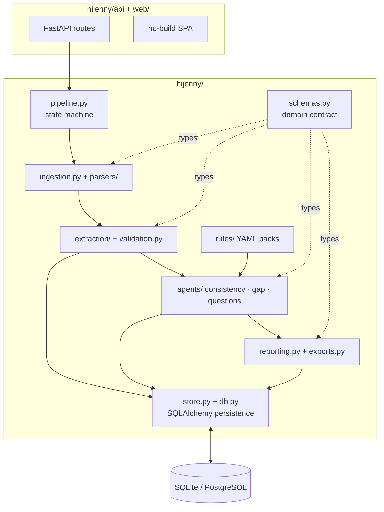

# HiJenny — Engineering Architecture

Status: MVP (v0.1), single-process, SQLite. The design keeps the evidence store
and model adapters swappable so the same pipeline can move to PostgreSQL +
object storage + a hosted LLM without changing stage logic.

## 1. Principles

1. **Evidence before reasoning.** Documents are parsed into pages/blocks, facts
   into a typed evidence store; every analysis step reads from the store.
2. **Deterministic workflow, pluggable semantics.** `hijenny/pipeline.py` owns
   the state machine; parsing/extraction/analysis/reporting are pure modules
   loaded at stage boundaries.
3. **Comparability gating.** Evidence carries a six-dimension vector; Type A
   contradictions require exact agreement on all six.
4. **Traceability by construction.** Evidence stores document id, page, verbatim
   quote (and table/bbox when available); the validator re-checks it
   independently.
5. **Idempotent, resumable runs.** SHA-256 document dedup, evidence fingerprints,
   stable finding/question dedup keys, supersede chains.

## 2. Component map



## 3. Module responsibilities

| Module | Responsibility | Key entry points |
|---|---|---|
| `hijenny/pipeline.py` | deterministic stages, run bookkeeping, async thread runner | `run_pipeline`, `start_pipeline`, `progress` |
| `hijenny/ingestion.py` | classify files, SHA-256 dedup, version/supersede, parse pages/blocks/tables, chunk, injection scan | `ingest_project`, `ingest_file` |
| `hijenny/parsers/` | PyMuPDF / python-docx / python-pptx / openpyxl adapters → `ParsedDocument`; injection pattern list | `parse_file` |
| `hijenny/extraction/` | rule + table extractors, dimension resolution, asset/trial resolution, LLM adapter, quote checks | `extract_project` |
| `hijenny/validation.py` | independent source verification and arithmetic checks | `validate_project` |
| `hijenny/agents/consistency.py` | comparability-vector partition → Type A/B/C/U findings | `run` |
| `hijenny/agents/gap.py` | YAML-checklist coverage, gap/technical/incomplete findings | `run` |
| `hijenny/agents/questions.py` | dedupe/merge findings + gaps into seller questions | `run` |
| `hijenny/rules.py` + `hijenny/rules/` | versioned, data-only due-diligence rule packs (46 rules) | `load_rules`, `select_rules` |
| `hijenny/reporting.py` | stage handler writing MD/DOCX/XLSX deliverables | `generate_project_outputs` |
| `hijenny/exports.py` | 6-sheet styled workbook + Markdown/DOCX renderers | `collect_export_data`, `build_workbook` |
| `hijenny/api/main.py` | REST + static SPA host, project-scoped file allowlist | `app` |
| `hijenny/cli.py` | `demo`, `run`, `ingest`, `status`, `projects`, `serve` | `main` |

## 4. Data model

```
projects ─ assets ─ clinical_trials
    │
    ├─ documents ─ document_pages ─ document_chunks
    │     (sha256, doc_type, doc_family, version, is_latest, supersedes,
    │      status, parse_quality, meta_json{injection_flags})
    │
    ├─ evidence (project, asset, trial, document, field_name, category,
    │      value_num/value_text/unit, population, arm, trial_key,
    │      data_cutoff, endpoint_def, assessment_method, comparable_key,
    │      page, table_name, quote, bbox_json, confidence, extractor,
    │      verification_status/note, fingerprint)
    │
    ├─ findings ─ finding_evidence
    │      (type, domain, severity, status, explanation, possible_causes,
    │       missing_information, recommended_action, rule_id, detail_json,
    │       dedup_key, created_by_run)
    │
    ├─ questions ─ question_evidence
    │      (priority, category, owner, required_documents, evidence_ids,
    │       finding_ids, status, review_status, locked, dedup_key)
    │
    ├─ coverage_items, review_events, agent_runs
```

Design notes:

* JSON payloads are stored as TEXT for SQLite portability; the helper layer
  serialises/deserialises, so swapping to `JSONB` on PostgreSQL is localised.
* `fingerprint` (document + field + value + page + quote hash) makes evidence
  extraction idempotent.
* `doc_family` + `version` + `supersedes` + `is_latest` drive the round-2
  lifecycle: active analysis uses latest documents only; history is retained.
* `review_events` is append-only (who/when/before/after), used for audit.
* Evidence ids referenced by findings/questions are validated on write; stale
  references are dropped when rows are rebuilt.

## 5. Pipeline state machine

```
CREATED → PARSING → EXTRACTING → VALIDATING → ANALYZING
        → GENERATING_QUESTIONS → HUMAN_REVIEW → REPORT_READY
```

Stage handlers have the signature `(session, project_id, force=False) -> dict`
and report stats. `force=True` recomputes a document/project from scratch
(delete/replace derived rows), while default runs are incremental:

* ingest: parse `uploaded`/`failed` docs, skip unchanged SHA-256;
* extract: skip documents with evidence; re-extract superseded docs only on force;
* consistency/gap/questions: recompute and upsert by stable dedup key; stale
  auto findings are marked `resolved`, human-reviewed/locked rows preserved;
* report: regenerated atomically after every run.

Runs execute in a daemon thread via `start_pipeline`; the API polls
`GET /api/runs/{id}` (`pipeline.progress`). A crash leaves a `FAILED` run row and
the project can be resumed with another run.

## 6. Comparability and finding classification

For each `(field_name, trial_key, arm)` evidence cloud:

1. Partition records by exact normalized dimensions
   `(population, data_cutoff, endpoint_def, assessment_method)`.
2. The largest group is the reference; values within tolerance (relative 2% for
   percentages/medians, exact for counts) are the same fact.
3. Reference value conflicts across **different documents** → Type A
   `data_inconsistency`.
4. Records differing **only** in data cutoff → Type B `version_difference`.
5. Records differing in population/method/endpoint definition → Type C
   `definition_difference` (definition outranks cutoff).
6. Records with missing required dimensions → U `comparability_unclear`.
7. Evidence sets for A/B/C/U are disjoint; findings carry
   `detail.values[]`, `detail.dims`, `detail.delta`, `detail.documents`.

Definition-only fields (`primary_endpoint`, `secondary_endpoints`,
`response_criteria`, design fields) are canonicalised and never produce Type A;
they can only produce a Type C definition conflict when the endpoints genuinely
differ (ORR vs PFS).

## 7. Verification layers

| Layer | Implemented in | Checks |
|---|---|---|
| Schema | Pydantic `EvidenceDraft` | numeric fields numeric, units, page ≥ 1, non-empty quote |
| Source | `validation.py` | verbatim quote substring of cited page; value/date present in quote; plausibility (0–100%, counts > 0); CR+PR ≈ ORR (0.5 pp); N ≤ sample size; CI ordering |
| Cross-document | `agents/consistency.py` | comparability gating; active documents only; verification-failed evidence excluded |
| Human | API PATCH + `review_events` | priority/severity/status edits logged; locked rows preserved |

## 8. Rules

YAML packs under `hijenny/rules/` describe checklist items:

```yaml
rule_id: onco2.data.subgroup
name: Subgroup results
applies_to: {therapeutic_area: oncology, phase: [2]}
dimension: efficacy
required_evidence:
  - {id: subgroup_results, fields: [subgroup_analysis], min_documents: 1,
     acceptable_texts: ["%"], label: "Results of pre-specified subgroup analyses"}
priority: medium
owner: Biostatistics
required_documents: ["Updated Clinical Study Report (CSR)"]
```

`hijenny/rules.py` validates and version-stamps packs; `hijenny/agents/gap.py`
evaluates coverage using structured evidence presence (no vector search), and
`not_found` always reads "not identified in the current package".

## 9. API surface

```
GET  /api/health, /api/llm-status
POST /api/projects                     GET /api/projects, GET /api/projects/{id}
POST /api/projects/{id}/documents      (multipart, multi-file)
GET  /api/projects/{id}/documents      GET /api/documents/{id}/pages/{n}
POST /api/projects/{id}/analyze        GET /api/runs/{id}
GET  /api/projects/{id}/evidence       GET /api/evidence/{id}
GET  /api/projects/{id}/findings       PATCH /api/findings/{id}
GET  /api/projects/{id}/questions      PATCH/DELETE /api/questions/{id}
GET  /api/projects/{id}/coverage, /stats, /review-events
POST /api/projects/{id}/exports/questions   POST /api/projects/{id}/exports/report
GET  /api/files/{path}                 (allowlisted to project documents/exports)
GET  /                                 (SPA)
```

## 10. Trust boundaries and security

* Documents are untrusted input. Rule extraction skips instruction-like
  sentences; the LLM adapter frames page text as data, validates JSON against
  `EvidenceDraft`, and drops any fact whose quote is absent from the page.
  Injection attempts are surfaced as `TECHNICAL_CONCERN` findings.
* No network by default: the rule extractor is local; `hijenny/llm.py` only calls
  out when `HIJENNY_LLM_API_KEY` is set and mode is `llm`/`hybrid`.
* Project-scoped queries everywhere; `/api/files` is allowlisted to
  `projects/<id>/{documents,exports}/...` and blocks traversal.
* Auth/SSO is deliberately out of MVP scope (org id and `X-Org-Id` hook exist).

## 11. Testing and evaluation

* 174 tests: parsers/ingestion, extraction/validation, agents/rules, API/exports,
  metrics, end-to-end pipeline (`tests/test_e2e.py` runs ingest → extract →
  verify → agents → report on the committed sample package and asserts
  provenance, planted findings, question quality, deliverable files, and the
  round-2 resolution lifecycle).
* `eval/` scores the pipeline against adjudicated ground truth; see
  `docs/EVALUATION.md` for metrics, numbers and limitations.
* CI (`.github/workflows/ci.yml`) installs the package, runs the full suite,
  regenerates the deterministic sample package and smoke-tests the CLI.

## 12. Extension points

| Need | Where to add |
|---|---|
| New document type / parser | `hijenny/parsers/`, classification map in `ingestion.py` |
| New clinical field | `FieldName` in `schemas.py`, extractor pattern, validation rule |
| New due-diligence checklist | YAML pack in `hijenny/rules/<area>/` |
| New analysis agent | new module in `hijenny/agents/`, stage mapping in `pipeline.py`, contract in `AGENTS_CONTRACT.md` |
| New output format | renderer in `hijenny/exports.py`, stage in `reporting.py` |
| PostgreSQL / S3 | `store.configure`, SQLAlchemy engine URL; object storage for `stored_path` |
| LLM provider | `hijenny/llm.py` (OpenAI-compatible) |

## 13. Deployment notes (MVP)

Single process: `uvicorn hijenny.api.main:app`. SQLite in `data/hijenny.db`,
uploads/exports under `data/projects/<project_id>/`. For production: move DB to
PostgreSQL, files to S3-compatible storage, run workers (Celery/RQ) for large
packages, put auth/SSO and audit export in front, and pin an approved LLM
endpoint with data-retention terms.
