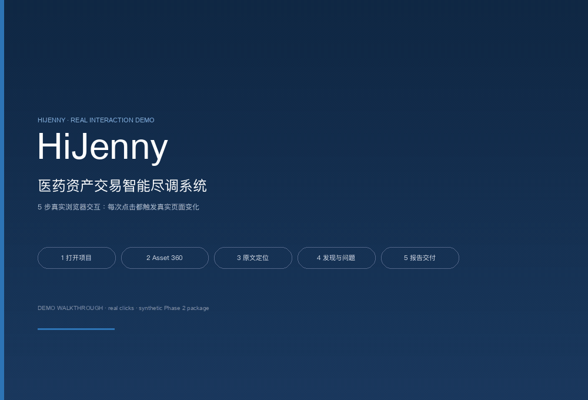
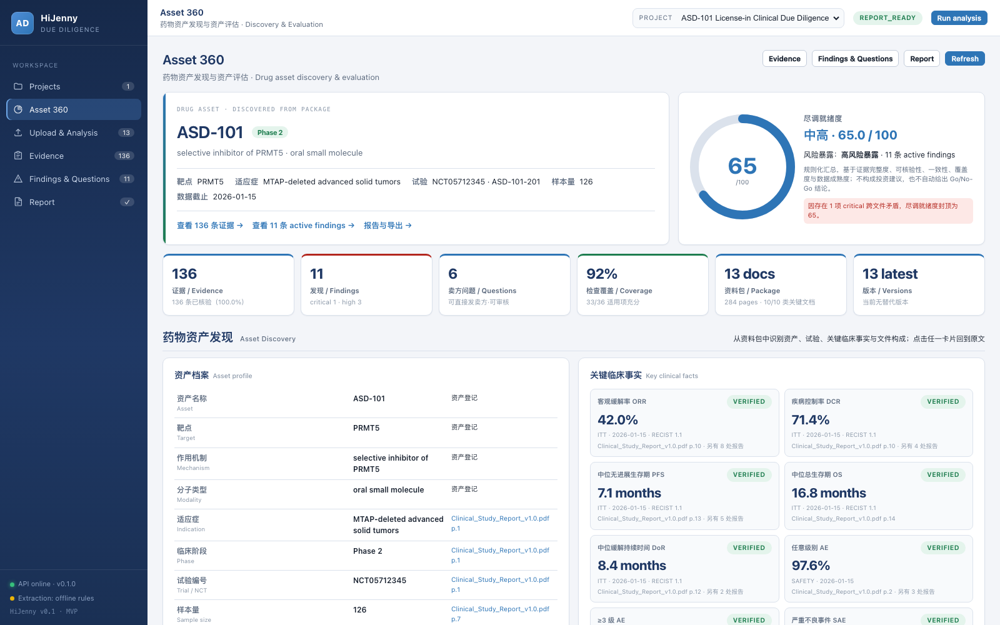
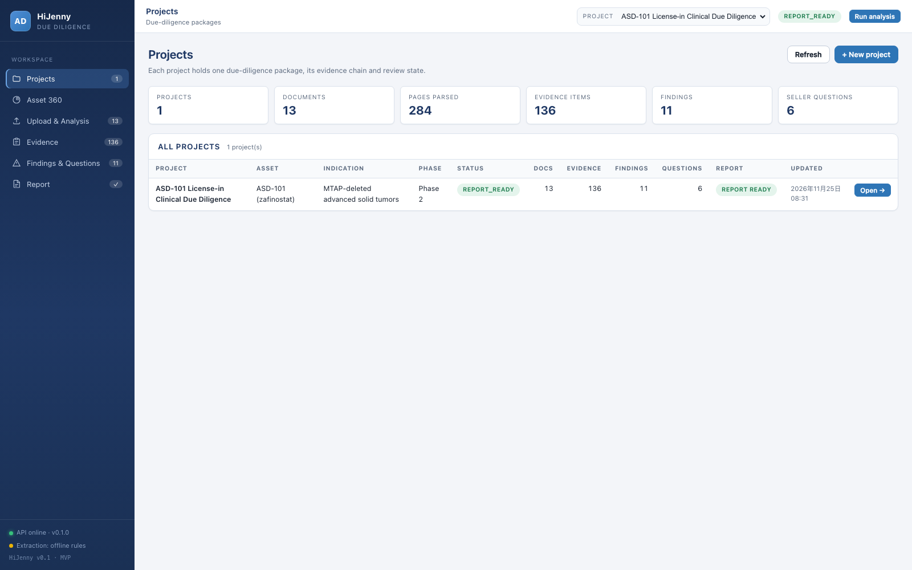
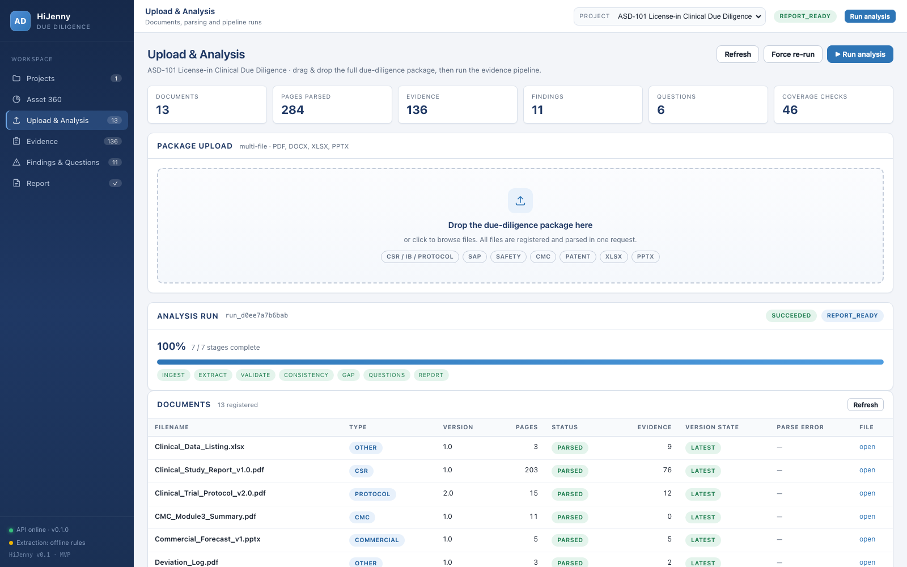
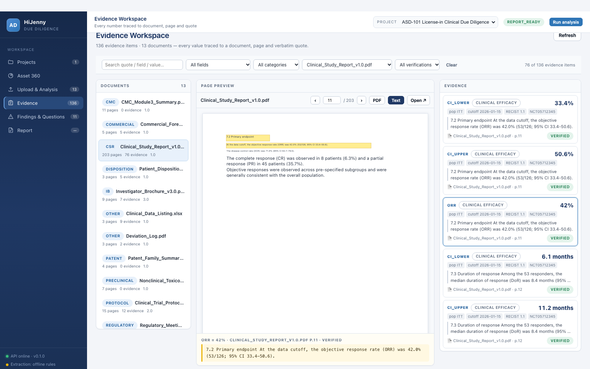
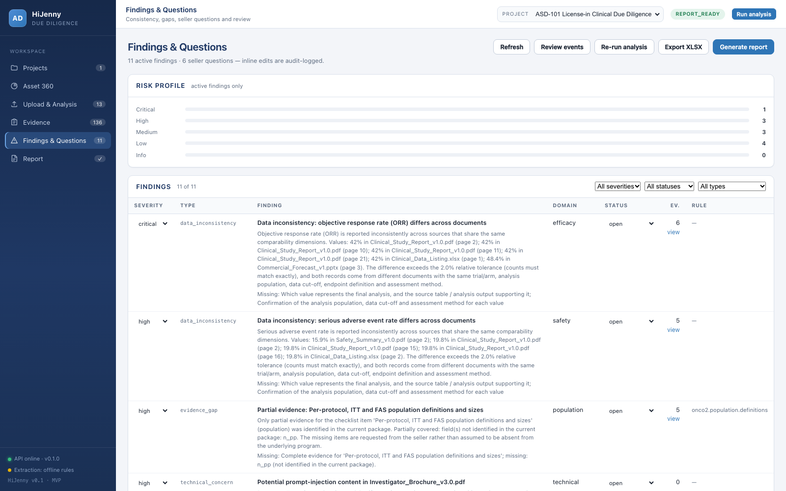
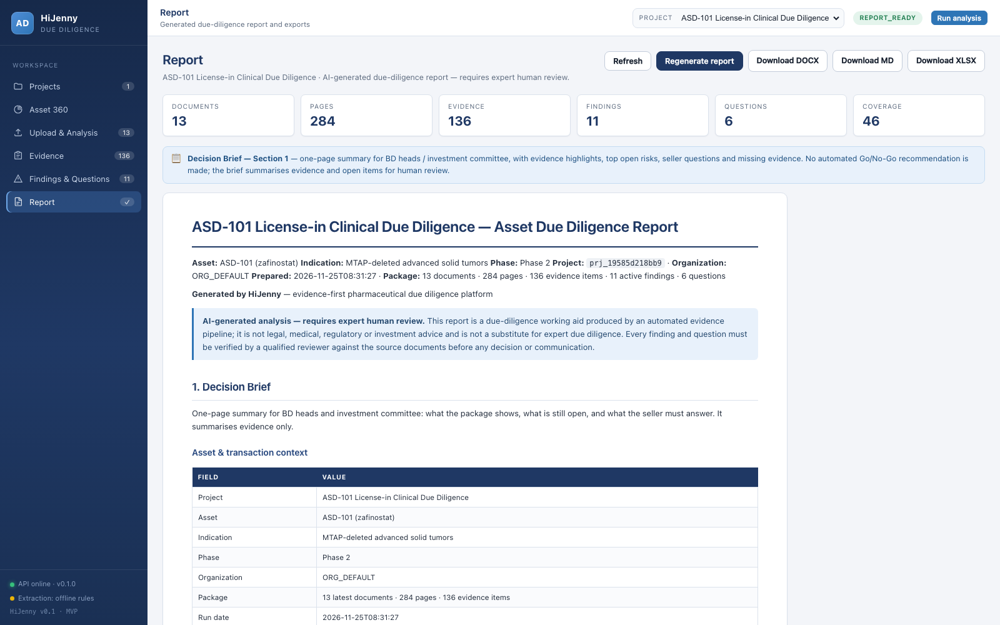

# HiJenny 演示指南 / Demo Guide

> 面向客户与投资机构的 10–15 分钟演示脚本。所有数据来自仓库内提交的**合成示例资料包**
> （ASD-101，13 份文档 / 284 页），用于展示产品能力，不代表真实客户数据。
> All data comes from the committed synthetic sample package; it demonstrates the
> product, not real-client performance.

---

## 1. 一键启动 / One-command start

```bash
cd HiJenny
./scripts/demo.sh
```

首次运行会自动：创建隔离的演示工作区 `demo_workspace/`（独立数据库，不影响你的 `data/`）
→ 解析 13 份文档 → 跑完整流水线 → 生成报告与 Excel → 启动服务。

打开 **http://127.0.0.1:8123/** 即可演示。停止用 `Ctrl+C`，重置删除 `demo_workspace/` 后重跑。

> 也可以分步执行：
> `python3 -m hijenny.cli demo-kit --out demo_workspace`
> `HIJENNY_DATA_DIR=demo_workspace/data HIJENNY_DB_PATH=demo_workspace/data/hijenny.db hijenny serve --port 8123`

演示交付物已放在 `demo_workspace/deliverables/`：报告 MD/DOCX/PDF + 8-Sheet Excel（含 Asset Evaluation / Discovery）。
仓库内另附一份快照：[docs/sample_output/](sample_output/)。

---

## 2. 10 分钟演示流程（客户版）

| 时间 | 页面 | 演示动作 | 要讲的话 |
|---|---|---|---|
| 0:00–0:30 | 封面 | 打开首页 Projects | “HiJenny 把卖方 1,000+ 页资料包变成可溯源尽调底稿，而不是 PDF 聊天机器人。” |
| 0:30–2:00 | **Asset 360** | 一屏展示资产档案、关键临床事实、8 维就绪度、A/B/C/U、Top 风险/问题；点击卡片跳转原文 | “药物资产发现 + 评估一屏汇总；65/100 是规则化尽调就绪度，因 critical 矛盾封顶，不构成投资建议。” |
| 2:00–3:00 | Projects | 展示 1 个项目、13 份文档、284 页、136 条证据、11 条发现、6 个问题 | “所有统计来自真实运行；不同颜色状态对应解析/分析完成度。” |
| 3:00–4:30 | Upload & Analysis | 展示文档清单、类型/版本/页数、7 阶段进度条 | “支持 PDF/PPTX/XLSX，自动识别 CSR/IB/SAP 等类型；版本更新会自动 supersede。” |
| 4:30–6:30 | Evidence | 点击 ORR 证据卡片 → 左侧文档树定位 CSR → 中间高亮第 11 页原文 → 右侧显示证据值/人群/cutoff/方法/校验状态 | “每个数字都能点回原文逐字引用；这里 42.0% 来自 CSR p11 ITT/RECIST 1.1/2026-01-15。” |
| 6:30–8:30 | Findings & Questions | 按严重度筛选；展示 critical ORR 矛盾（42.0% vs 48.4%）、Type B 版本差异、Type C 定义差异、缺口、注入风险 | “系统只比较六维可比的数据；不同 cutoff/人群不会误判为矛盾。” |
| 8:30–9:30 | Findings | 打开 1 条 critical finding / 1 条卖方问题，展示证据链接、责任部门、所需文件 | “问题可直接发卖方，去重合并、可审核、可导出。” |
| 9:30–10:30 | Report | 展示 Decision Brief、Top risks、问题清单；下载 MD/DOCX/PDF/XLSX | “交付物是 Decision Brief + 证据矩阵 + 问题清单；不自动给 Go/No-Go。” |

**关键数字**：136 条证据全部通过原文校验；11 条 active findings（1 critical / 3 high）；
6 条卖方问题；46 项覆盖度；284 页端到端约 11 秒（默认离线模式，0 次 LLM 调用）。

---

## 3. 15 分钟演示流程（投资机构版）

在 10 分钟流程基础上补充：

1. **问题与时机（2 分钟）**：License-in 交易资料包巨大、跨职能审阅 2–4 周、版本/人群混淆导致误判；通用 LLM 不可溯源。
2. **技术壁垒（3 分钟）**：Evidence-first 四层模型 + 六维可比性门控 + 逐字校验 + 人工复核闭环；
   `docs/ARCHITECTURE.md` 看架构，`docs/EVALUATION.md` 看评测。
3. **产品演示（6 分钟）**：按上面 10 分钟流程走核心 4 个页面。
4. **质量与评测（2 分钟）**：合成语料 36/36 事实、findings P/R/F1 100%、引用 100%、v1→v2 11/11、注入控制 PASS；
   **明确说明这是合成语料，不是真实客户准确率**，真实试点正在用双人裁定 benchmark 验证。
5. **商业化与路线图（2 分钟）**：3–5 天试点交付、¥9.8k–29.8k/项目、临床 DD → CMC/注册/IP → 平台；
   见 `docs/PRODUCTION_ROADMAP.md` 的 90 天计划。

配套材料：
- 投资/客户路演 PPT：[docs/HiJenny_Pitch.pptx](HiJenny_Pitch.pptx)（PDF 版 `HiJenny_Pitch.pdf`）
- 示例交付物：[docs/sample_output/](sample_output/)
- 产品设计：[docs/PRODUCT.md](PRODUCT.md) · 架构：[docs/ARCHITECTURE.md](ARCHITECTURE.md) · 评测：[docs/EVALUATION.md](EVALUATION.md)

---

## 4. 动图 / Animated walkthrough（约 11 秒）



5 步：打开项目 → Asset 360（发现+评估）→ 点击 ORR 42.0% 回到 CSR 第 11 页 →
自动分类 A/B/C/U 与缺口 → 交付 Decision Brief + 8-Sheet Excel。
高清版：[demo_walkthrough.mp4](assets/demo_walkthrough.mp4)。

重新生成（需要本地 demo 服务）：

```bash
# terminal 1
./scripts/demo.sh
# terminal 2
python3 tools/capture_screenshots.py --base http://127.0.0.1:8123 --out docs/assets/screenshots
python3 tools/make_demo_gif.py
```

## 5. 截图（可直接放进演示文稿）

| 页面 | 截图 |
|---|---|
| **Asset 360（发现 + 评估）** |  |
| Projects |  |
| Upload & Analysis |  |
| Evidence Workspace（ORR 原文高亮） |  |
| Findings & Questions |  |
| Report |  |

---

## 6. 常见演示问题

**Q: 这是真实数据吗？**
A: 不是。仓库提供的是合成 Phase 2 肿瘤资料包，用于可复现演示；真实客户资料需要脱敏并在私有环境运行。

**Q: 准确率多少？**
A: 合成语料上 36/36 字段事实、引用 100%、findings P/R/F1 100%；真实资料正在按
`docs/PRODUCTION_ROADMAP.md` 的双人裁定 benchmark 验证。不要把这些数字说成真实客户性能。

**Q: 能私有化吗？**
A: 默认离线规则模式不出网；LLM 为可选。企业版路线包含 VPC/私有化、SSO/RBAC、加密与审计。

**Q: 和 PDF 聊天机器人有什么区别？**
A: 先建结构化证据库再分析；每条结论带文件/页码/逐字引用；可比性门控避免误报；交付物是问题清单与 Decision Brief。

**Q: 演示环境端口被占用？**
A: `PORT=8124 ./scripts/demo.sh`。

---

## 7. English quick summary

```bash
./scripts/demo.sh          # builds demo_workspace/ and serves http://127.0.0.1:8123/
```

A 10-minute customer demo: **Asset 360** (discovery + evaluation dashboard) → Projects → Upload & Analysis → Evidence (click ORR evidence,
jump to CSR page 11, highlighted quote) → Findings & Questions (Type A/B/C, gaps, injection)
→ Report (Decision Brief + MD/DOCX/PDF + Excel). The 15-minute investor version adds
problem/why-now, the comparability-gating architecture, synthetic-corpus benchmark with an
explicit caveat, and the pilot/commercialization roadmap. All demo data is synthetic and
the deliverable is a human-review draft, never an automated Go/No-Go.
