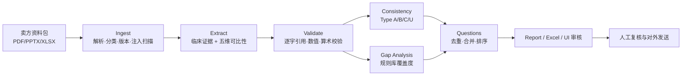

# HiJenny 产品设计文档

> 版本：v0.1（MVP）· 定位：AI-native 医药资产交易智能尽调平台
> 首个场景：创新药 License-in 买方临床尽职调查 · 首个适应症：肿瘤

---

## 1. 一句话定位

**HiJenny 把卖方 1,000+ 页资料包变成一份"每条结论都能点回原文"的临床尽调工作底稿：证据库 → 跨文件一致性 → 证据缺口 → 卖方问题清单 → 可审核报告。**

它不是 PDF 聊天机器人，而是一套 **evidence-first + workflow-driven** 的尽调生产系统。

## 2. 目标用户与使用场景

| 角色 | 在 HiJenny 里做什么 |
|---|---|
| BD / 投资负责人 | 看 Decision Brief、风险排序、问题清单，决定是否继续推进 |
| 临床开发 / 医学 | 审核疗效、安全性证据与矛盾项，确认问题优先级 |
| 生物统计 | 审核分析人群、终点定义、统计方法类问题 |
| 注册 / 安全 / 法务 | 处理各自域内的缺口、版本差异与合规问题 |
| 交易对手（卖方） | 接收去重、可执行、带证据编号的问题清单并回复 |

典型场景：买方收到卖方 10–30 份文件（CSR / IB / Protocol / SAP / Safety / CMC / 专利 / 商业预测），需要在 3–5 个工作日内完成初筛，形成 "哪些数据可信、哪里有矛盾、缺什么、要问什么"。

## 3. 要解决的核心问题

通用大模型直接读 1,600 页并生成报告，有三个致命问题：

1. **遗漏细节**：关键数字（ORR、样本量、cutoff）淹没在附录表格里；
2. **版本混淆**：v1 与 v2、不同 cutoff 的数据被混为一谈；
3. **无法溯源**：报告里的每个数字无法证明来自哪份文件的哪一页。

HiJenny 的解法：**先建证据数据库，再做专业分析**。分析对象是可查询、可比较、可验证的结构化证据，而不是原始 PDF 文本。

## 4. 产品原则

1. **Every claim must be traceable.** 每条证据保存 `document + page + verbatim quote`（表格含 table/bbox）；引用由程序逐字校验。
2. **Every risk must be explainable.** 每条 Finding 说明类型（矛盾/版本/定义/缺口）、涉及证据、可能原因与建议动作。
3. **Every question must be actionable.** 每个卖方问题有优先级、责任部门、所需文件、证据链接和提问理由；支持去重合并与人工审核。

## 5. 核心工作流



状态机（确定性、可恢复、可审计）：

```
CREATED → PARSING → EXTRACTING → VALIDATING → ANALYZING
        → GENERATING_QUESTIONS → HUMAN_REVIEW → REPORT_READY
```

每个阶段幂等：证据按指纹去重，Finding/Question 按稳定 dedup key upsert，重跑不产生重复数据；新版资料上传后自动 supersede 旧文档并重算。

## 6. 证据链数据模型

```
Project → Asset / Trial
   │
   ├── Document（SHA-256、版本、doc_family、supersede 链、解析质量、注入标记）
   │      └── Page（文本、blocks、bbox、表格）
   │
   ├── Evidence（字段、数值/单位、页码、表格、逐字引用、抽取器版本、置信度、
   │            可比性向量：trial / arm / population / data cutoff / endpoint_def / assessment method）
   │
   ├── Finding（A 矛盾 / B 版本差异 / C 定义差异 / U 可比性不明 / 证据缺口 / 技术风险）
   │      └── finding_evidence 关联
   │
   └── Question（优先级、责任部门、所需文件、证据链接、审核状态）
          └── question_evidence 关联
```

**可比性向量是本产品的技术核心**：只有六个维度一致（或缺失被显式标注）时才做数值一致性判断；否则优先输出"版本差异/定义差异/可比性待确认"，而不是把不可比的数据判成矛盾。这一条决定了误报率，也决定了医生/BD 是否信任系统。

## 7. 分析方法

### 7.1 一致性检查（Type A / B / C / U）

| 类型 | 条件 | 输出 |
|---|---|---|
| A 直接矛盾 | 同试验、同组、同人群、同 cutoff、同终点定义、同评价方法下数值不同（相对容差 2%，计数精确） | critical/high Finding，附双方数值、文件、页码、差值 |
| B 版本差异 | 仅 data cutoff 不同（如 IB 用旧 cutoff） | 低优先级提示：确认最新版本，不判为矛盾 |
| C 定义差异 | 人群/评价方法/终点定义不同（如 FAS/BICR vs ITT/investigator） | 中优先级：要求给出 like-for-like 对比 |
| U 可比性不明 | 关键维度缺失，无法比较 | 低优先级：先补元数据，不指控卖方 |

每个 (field, trial, arm) 证据云只划分一次，A/B/C/U 证据集互斥；同文档重复值不算 Finding（除非是不同分析人群的 sensitivity analysis）。

### 7.2 证据缺口

基于可版本化的 YAML 尽调检查清单（肿瘤 Phase 1/2/3、ORR/PFS/OS、AE/DLT、统计质量、数据质量），按 **结构化证据是否存在** 判断覆盖度：

`sufficient` / `partial` / `not_found` / `not_applicable` / `not_reviewed`

语言纪律：**"未在当前资料包中识别到" ≠ "卖方没有做"**。缺口 Finding 必须写明"仅针对本次提交材料"，并给出建议索取的文件。

### 7.3 卖方问题生成

- 一条 Finding 簇（同字段/同类型）合并为一个问题，优先级取簇内最高；
- 问题正文用 BD 专业英语：说明现状 → 为什么重要 → 具体索取什么 → 期望的验证方式；
- 输出 owner（Clinical / Safety / Biostatistics / Regulatory / CMC / IP / Legal）、所需文件、证据编号；
- 支持人工编辑、锁定、合并、关闭、导出 Excel；人工编辑过的行在重跑时不被覆盖。

## 8. 交付物（对应原始需求 8 项）

| 原始需求 | 本 MVP 交付 |
|---|---|
| Asset Profile | 报告 §3 + Excel「Asset Profile」+ **Asset 360 仪表盘**（资产发现与评估） |
| Evidence Matrix | 报告 §4 + Excel「Evidence Matrix」（136 行，含页码/引用/校验状态） |
| Consistency Report | 报告 Findings 章（按严重度分组，A/B/C/U，附证据引用） |
| Evidence Gap Report | 报告 Gap 章 + Excel「Coverage」（46 项检查清单状态） |
| Risk Register | Findings 即风险登记表（类型/严重度/状态/证据） |
| Seller Question List | 核心交付物：Excel「Questions」+ 报告 §7 + UI 编辑/导出 |
| Due Diligence Report | Markdown + DOCX（Decision Brief 优先） |
| Decision Brief | 报告 §1：资产概览、证据支持点、Top 风险、Top 问题、缺失证据、明确"不自动给 Go/No-Go" |

## 9. 产品界面（5 个页面）

1. **Projects**：项目列表 / 新建（资产、适应症、阶段）。
2. **Upload & Analysis**：拖拽批量上传、解析状态、版本/页数、Run/Force re-run、阶段进度轮询。
3. **Evidence Workspace**：三栏（文档树 | PDF 页码预览 | 证据卡片）；点击证据跳转到原文页并显示引用片段。
4. **Findings & Questions**：严重度/优先级/类型/状态筛选，行内编辑、审核事件、删除、导出 Excel、重跑。
5. **Report**：渲染 Markdown 报告 + MD/DOCX/XLSX 下载。

## 10. MVP 范围与非目标

**已实现**：临床尽调（肿瘤 Phase 1–3）、PDF/PPTX/XLSX 解析、证据/一致性/缺口/问题/报告全链路、审核 UI、Excel/DOCX 导出、v1→v2 版本回流。

**明确不做**（与产品计划一致）：完整 CMC/IP/商业尽调、自动 FTO、rNPV、交易条款、自动 Go/No-Go、自动发邮件给卖方、自主外网检索、多 Agent 辩论、知识图谱、自训练模型、生产级 SSO/审计导出。

## 11. 质量与评测

评测集：合成真实感资料包 + 人工裁定 ground truth（36 条事实、11 个 Finding 议题、5 项覆盖度期望；v2 回流 11 个议题状态）。

当前构建（详见 [EVALUATION.md](EVALUATION.md)）：

- 抽取准确率 36/36 = 100%（27/27 字段）
- Findings 对 11 个裁定议题：P 100% / R 100% / F1 1.00
- 引用准确率 100%（独立逐字复核）
- 覆盖度状态 5/5，问题主题覆盖 5/5
- 生命周期 v1→v2：11/11 状态转移正确
- 注入攻击控制：PASS（未采纳、已标记）
- 284 页端到端约 11 秒，0 次 LLM 调用

**诚实边界**：以上是合成语料上的工程证据，不是真实客户数据性能证明；真实试点需双人独立标注、预注册协议与留出集。

## 12. 安全与合规设计

- **项目级数据隔离**：所有查询按 project 过滤；organization 字段预留多租户。
- **不可信文档**：文档内容永远作为数据处理，不作为指令；规则层跳过指令式语句并记录 `injection_flags`，LLM 适配层用数据边界 prompt + 输出 schema 校验，引用不在页面则丢弃。
- **模型调用可控**：默认离线规则模式，不出网；LLM 模式通过环境变量显式开启，客户可自选合规端点/私有化部署。
- **审计**：review_events 记录谁在何时修改了 Finding/Question 的哪些字段；报告带"AI 生成、必须人工复核、不构成建议"声明。
- **文件服务白名单**：仅允许项目 documents/exports 目录，阻断路径穿越。

## 13. 商业化试点设计

**AssetDD Clinical Pilot（现更名 HiJenny Clinical Pilot）**

| 项 | 内容 |
|---|---|
| 交付周期 | 3–5 个工作日（取决于资料完整性） |
| 输入 | 一个肿瘤资产的临床资料包（≈500–2,000 页） |
| 输出 | Evidence Matrix、Consistency Report、Gap Report、Seller Question List、Decision Brief |
| 定价建议 | ¥9,800–29,800 / 项目（需客户访谈验证） |
| 交付模式 | AI 自动生成 + 专家复核；明确区分 AI 工作与人工咨询 |
| 核心 KPI | 处理 1,000–2,000 页；关键字段抽取准确率 ≥95%；引用准确率 ≥98%；高优先级 Finding 召回 ≥90%；人工工时节约 ≥50%；问题可直接采用 ≥70%；单项目计算成本 <¥500 |

## 14. 路线图

| 版本 | 时间 | 核心能力 |
|---|---|---|
| **V0.1（当前仓库）** | 已完成 | 资料包 → 临床证据 → 一致性/缺口 → 卖方问题 → 报告，端到端 |
| V0.5 | 6 周 | 真实试点包、专家裁定 scorecard、OCR、审核工作流打磨 |
| V1.0 | 12 周 | 多租户/SSO、审计导出、PostgreSQL + 对象存储、版本 diff UI |
| V2.0 | 6 个月 | CMC + Regulatory/IP Agent、Risk Register 增强、IC Decision Brief |
| V3.0 | 12 个月 | 药企 BD Intelligence Platform（组合、基准、跨交易学习） |

## 15. 关键风险与对策

| 风险 | 对策 |
|---|---|
| 抽取误报/漏报导致不信任 | 四层验证 + 人工复核 + 引用逐字校验；报告明确"草稿"定位 |
| 不可比数据被判成矛盾 | 六维可比性门控；A/B/C/U 分类；误报纳入评测集 |
| 卖方资料格式千差万别 | 规则 + 表格解析 + 可选 LLM 混合；OCR 路线图；解析质量指标暴露给用户 |
| 保密与模型合规 | 默认离线；LLM 由客户选择端点；项目隔离与审计 |
| 商业价值被通用模型替代 | 壁垒在"结构化证据体系 + 专家验证的规则/问题体系 + 真实交易流程嵌入" |
